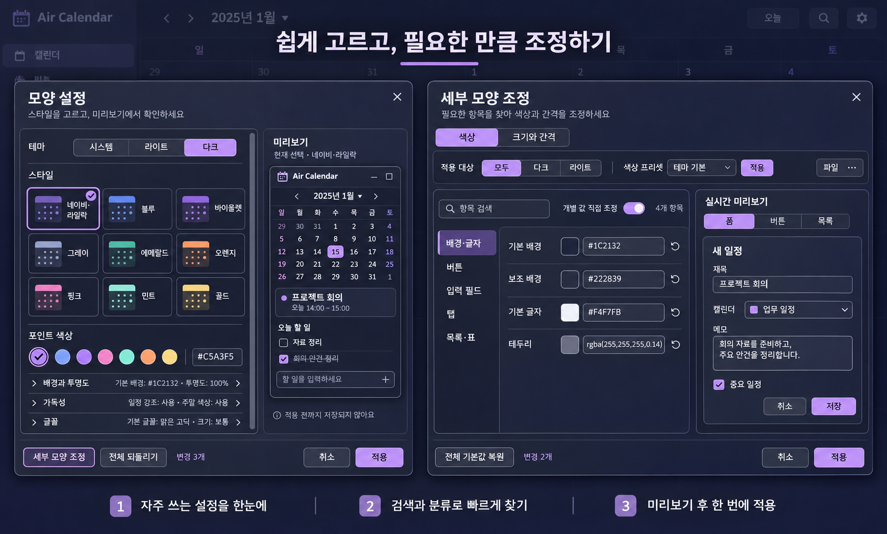

# 모양 설정과 세부 모양 조정 재구성

2026-11-06. 사용자가 제공한 다크·라이트 모드의 모양 설정, 세부 조정, 색상 선택창과 도구 모음 아이콘을 대상으로 한 개발 소스 변경입니다. 기존 일정·위젯·개인 설정을 테스트 입력으로 사용하지 않습니다.

## 구성안

기본 이미지 생성 도구(imagegen)로 제작한 시안입니다. [제작 프롬프트](../../artifacts/appearance-redesign-20261106/concept-prompt.txt)를 보관했습니다. 시안의 배치 원칙을 Qt 레이아웃과 공통 의미 토큰으로 구현하며, 이미지 속 문구보다 실제 동작 의미를 우선합니다. 특히 세부 조정의 ‘모두/다크/라이트’는 앱 모드 변경이 아니라 **프리셋 분류**라고 명확히 표시합니다.

기본 창은 테마 선택 → 작은 스타일 카드 → 포인트 색상 → 배경·투명도/가독성/글꼴의 연속 흐름을 유지합니다. 카드에서 가족 이름을 반복하지 않고, 실제 편집 영역 폭에 따라 3·2·1열로 정렬합니다. 넓을 때 미리보기는 오른쪽에 고정하고, 좁을 때 위로 이동합니다. 하단의 세부 모양 조정·되돌리기·변경 요약·적용/취소는 본문 스크롤과 분리합니다.

세부 창은 색상과 크기·간격을 구분하고, 검색과 영역별 탐색으로 필요한 값을 찾습니다. 추천 항목과 전문가 보기는 같은 컨트롤 레지스트리를 공유합니다. 긴 색상 값은 입력란과 툴팁에서 확인할 수 있고, 실시간 미리보기는 실제 폼·버튼·목록 컨트롤을 사용합니다. JSON 가져오기/내보내기와 전체 초기화도 유지합니다.

## 색상·경계·보조 창

- 다크·라이트·시스템·사용자 색상은 현재 편집 중인 초안에서 해석합니다. 공통 창 표면, 모드 선택, 카드, 라벨, 미리보기와 하위 색상 선택창이 같은 초안을 사용하도록 연결합니다.
- 모달 본문은 불투명한 공통 읽기 표면을 사용하며, 메인 화면의 배경·투명도 설정을 바꾸는 기능은 유지합니다.
- 공통 그림자는 중심 오프셋 0, 사방 28 논리 픽셀의 대칭 영역으로 강화합니다. 어두운 배경에서도 외곽을 구분하는 얇은 중성 선을 추가하고, 그림자 도구 창은 입력·포커스를 받지 않습니다. 본문에는 그래픽 효과를 적용하지 않습니다.
- 큰 DPI/창 크기로 그림자 도구 자체가 과도한 버퍼를 요청하지 않도록 64MiB 상한을 검사합니다. 안전 범위를 벗어나면 그림자만 숨깁니다.
- 모양 설정은 팔레트 아이콘을 사용합니다. 일반 설정은 단일 기어로 정리하고 두 아이콘에 여백을 두어 작은 도구 모음에서도 가장자리가 잘리지 않게 합니다.
- 앱의 색상 선택 호출은 Qt 선택창을 명시하고 기존 알파 선택 옵션을 보존합니다. 운영체제 소유의 색상 선택창에는 공통 프레임을 강제로 끼워 넣지 않습니다. Qt 색상창은 전체 폭의 한 줄 제목과 큰 글꼴을 고려한 높이를 사용합니다. [Qt 색상 선택 옵션 문서](https://doc.qt.io/qt-6/qcolordialog.html#ColorDialogOption-enum)
- 선택한 알파는 적용·저장·다시 열기에서도 보존합니다. 특히 1/255 투명도를 CSS의 불투명 값 `1`로 오해하지 않도록 모호하지 않은 소수로 저장하며, 기존 CSS `1 = 완전 불투명` 의미는 유지합니다.

## 저장과 취소

모양 설정의 세부 조정창은 수락해도 부모 초안만 바꿉니다. 부모 창에서 취소하면 모양과 토큰을 저장하지 않습니다. 독립 실행한 세부 조정창의 적용, 명시적인 색상·metric 초기화, 기존 metric override 보존, 시스템 모드·사용자 색상 원본의 의미도 유지합니다. 저장된 대문자 색상·잘못된 색상도 창을 열거나 취소하는 것만으로 정규화·삭제하지 않습니다. 공통 읽기 도우미가 시도하는 정규화 쓰기는 저장 원본과 분리하고, 창의 초안에서만 처리합니다.

모든 색상·metric 컨트롤은 검색이나 영역 전환으로 숨겨져도 유지됩니다. 보이지 않는 값을 누락해 저장하거나 JSON/프리셋 적용 범위를 줄이지 않습니다. metric의 기존 `_font_pt` 내부 키는 호환용 이름이며 실제 논리 픽셀 계약을 유지합니다.

## 검증과 한계

검증은 임시 INI와 장치·DB·네트워크 접근을 차단한 Qt 실행으로 수행합니다. 다크·라이트·사용자·시스템 모드, 좁은 창과 큰 글꼴, 선택/검색/부분 및 전체 초기화, 부모 초안 수락·취소, 색상 알파와 취소 결과를 확인합니다. 그림자는 100·125·200%의 네 방향 픽셀, 검은 배경의 외곽 구분, 본문 투명 영역, 중첩 모달과 종료 수명주기를 검사합니다. 아이콘도 16·20·24 논리 픽셀과 여러 DPR에서 가장자리 여백을 확인합니다.

프로젝트의 `artifacts/appearance-redesign-20261106/`와 `artifacts/modal-shadow-strength-20261106/`에 각 검사 XML·격리 기록·렌더 이미지를 보관합니다. 렌더 이미지는 실제 Qt 위젯의 offscreen 출력이며 Windows 사용자 화면 자동 조작을 완료했다는 증거가 아닙니다. 버전 기록·실제 실행 폴더 반영과 최종 확인 결과는 별도 적용 영수증에 기록합니다.

최종 31개 모듈의 통합 검사는 408건 모두 통과했습니다(실패·오류·건너뜀 0). 제품 파일 8개의 검증 전후 SHA가 일치하며, 격리 감사에서 원본 QSettings 생성과 DB·네트워크·장치 접근 시도는 모두 0입니다. 19개 로케일의 새 문구 22개와 한국어·영어 안내 문구 외에는 기존 번역 값을 보존했고, 프로젝트의 정규 JSON 형식·키·자리표시자 검사를 통과했습니다. 새 문구는 한국어·영어를 제공하고 다른 언어에서는 영어 대체 문구를 사용합니다.

첫 통합 검사 기록도 남겼습니다. 변경된 버튼 문구를 찾던 테스트, 전역 필터를 제거하던 새 테스트의 간섭, 번역 JSON 저장 형식, 과거의 앱 인자 전달 문자열을 고정하던 검사를 교정했습니다. 확장 UI 검사 중 Google 설정창을 만들던 기존 테스트에는 빈 저장소를 명시해 개인 DB 조회를 시도하지 않도록 했습니다. 이 과정에서 실제 DB 연결은 차단됐으며, 최종 검사에서는 해당 시도도 없어졌습니다.

최종 화면: [라이트 모양 설정](../../artifacts/appearance-redesign-20261106/render-final/light-wide.png), [다크 모양 설정](../../artifacts/appearance-redesign-20261106/render-final/dark-wide.png), [큰 글꼴·좁은 창](../../artifacts/appearance-redesign-20261106/render-final/narrow-24pt.png), [세부 조정과 사방 그림자](../../artifacts/appearance-redesign-20261106/editor-dark-wide-shadow-qt-composite.png), [색상 선택창](../../artifacts/color-picker-independent-20261106/qt-color-picker-light-offscreen.png). 마지막 그림자 이미지는 Qt의 별도 그림자 표면과 본문을 위치대로 합성한 offscreen 출력입니다.
