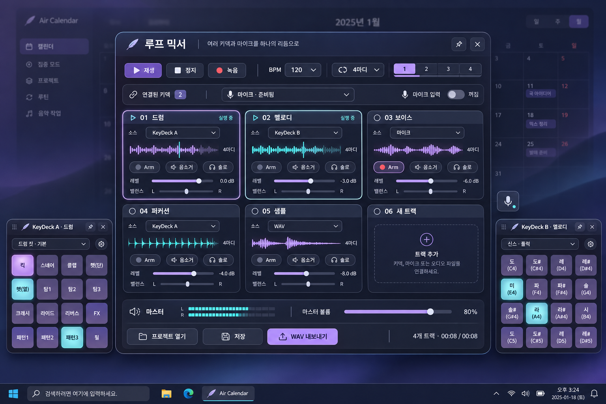
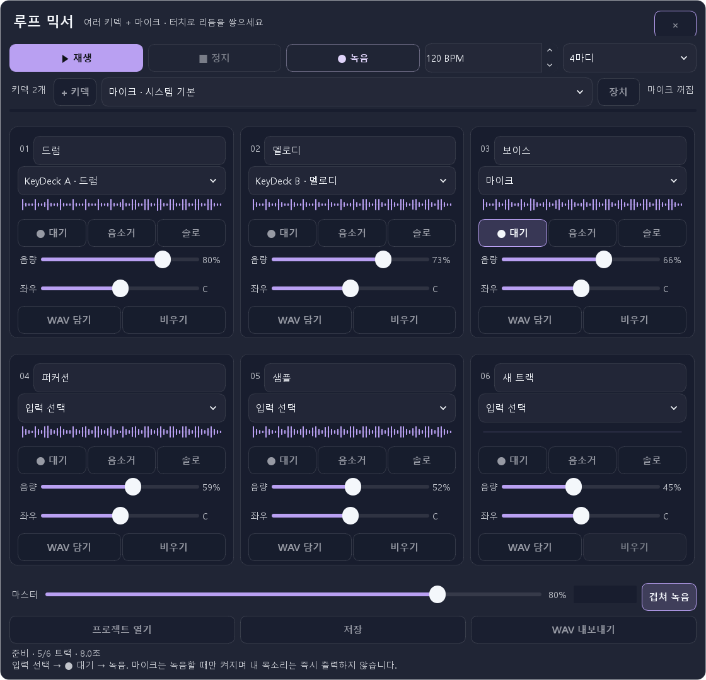

# 터치 중심 루프 믹서 키덱

기존 연주·루프 모달의 진입점을 독립적인 **루프 믹서 위젯**으로 통합했습니다. 여러 KeyDeck과 마이크, WAV를 여섯 트랙에 연결해 한 길이의 루프를 만들고 섞습니다. 기존 사용자 덱·단일 녹음·4트랙 루프 데이터는 삭제하지 않습니다.

시안은 기본 이미지 생성 도구로 제작했습니다. 프롬프트는 프로젝트의 `artifacts/loop-mixer-20261106/concept-prompt.txt`에 보관했습니다. 시안의 기본색·포인트색·카드 구성은 실제 앱의 공통 테마와 글자 크기 체계로 구현했습니다.

## 실행과 사용

1. 상단 **위젯 → 루프 믹서 위젯 열기**를 선택합니다. 일반 키덱·비트메이커 키덱의 **우클릭 → 루프 믹서 위젯 열기**, **위젯 관리자 → 위젯 추가 → 루프 믹서**에서도 엽니다. 이미 있는 믹서는 새로 만들지 않고 앞으로 가져옵니다.
2. **+ 키덱 → 드럼 키덱 추가 / 멜로디 키덱 추가**로 독립된 패드를 만듭니다. 기존 키덱을 여러 개 연결해도 됩니다.
3. 각 트랙의 입력에서 해당 키덱, **마이크**, **WAV 파일**을 선택합니다. WAV는 **WAV 담기**로 불러옵니다.
4. 녹음할 트랙의 **● 대기**를 켜고 **● 녹음**을 누릅니다. 대기한 트랙들을 동시에 한 바퀴 녹음한 뒤 자동으로 반복 재생합니다. 기본은 120 BPM·4마디입니다.
5. 재생 중 다른 트랙을 대기시키고 다시 녹음하면 기존 루프 위에 소리를 더할 수 있습니다. **겹쳐 녹음**을 끄면 기존 녹음의 교체 여부를 확인합니다.
6. 트랙별 **음소거·솔로·음량·좌우**와 마스터 음량으로 믹스를 조절합니다. 솔로가 켜진 트랙이 있으면 해당 트랙들만 들립니다.
7. **저장**은 편집 가능한 프로젝트와 인접 WAV 폴더를 보관합니다. 다른 PC로 옮길 때 두 항목을 함께 옮깁니다. **WAV 내보내기**는 현재 음소거·솔로·음량·밸런스를 적용한 한 바퀴를 출력합니다.

프로젝트와 편집값은 자동 저장합니다. 슬라이더를 누르거나 트랙 이름을 편집하는 동안에는 저장 때문에 조작을 끊지 않습니다. 파일 저장 요청을 받았다는 사실과 실제 저장 완료를 구분하며, 실패하면 기존 프로젝트와 저장 위치를 보존합니다.

## 터치 규칙

- 주요 버튼은 48 논리 픽셀 이상, 슬라이더 조작 영역과 소스 선택은 44 픽셀 이상입니다. 음량 막대의 원하는 곳을 직접 누르거나 끌 수 있습니다.
- 트랙은 창 너비에 따라 3열·2열·1열로 배치합니다. 트랙 영역은 터치로 스크롤하고, 재생·정지·녹음과 저장은 고정 영역에 둡니다.
- KeyDeck은 여러 손가락으로 서로 다른 패드를 동시에 누를 수 있습니다. 같은 접촉을 마우스 입력으로 중복 연주하지 않으며, 패드를 누른 채 다른 곳으로 이동해도 새 소리를 내지 않습니다.
- 취소·숨김·페이지 전환 때 눌린 상태를 해제합니다. 소리 패드의 다중 터치와 일반 매크로 키의 한 번 실행 의미를 구분합니다.
- 선택된 대기·음소거·솔로·겹쳐 녹음은 포인트색으로 표시합니다. 소스 선택에는 방향 표시를 별도로 그려 플랫폼의 기본 화살표가 빠져도 알아볼 수 있게 했습니다.
- 마우스 휠은 BPM·소스·음량·밸런스를 바꾸지 않습니다. 트랙 비우기와 기존 녹음 교체는 확인 후 처리합니다.

## 마이크와 여러 위젯

마이크는 **마이크 소스 트랙을 대기시킨 뒤 녹음을 눌렀을 때만** 엽니다. 한 바퀴 완료·정지·숨김·삭제·종료 시 입력을 닫습니다. 소리가 스피커에서 다시 마이크로 들어가는 상황을 피하기 위해 실시간 목소리 모니터링은 제공하지 않습니다. 녹음한 목소리는 다음 반복부터 들립니다.

여러 키덱을 동시에 연결할 수 있으며, 재생 중 연결된 키덱의 원래 출력과 믹서 출력을 중복 재생하지 않습니다. 한 번에 활성화할 수 있는 루프 믹서는 하나입니다. 다른 믹서가 사용 중이면 해당 위젯에서 먼저 정지하도록 안내합니다. 복제한 믹서는 별도 프로젝트 파일을 사용합니다. 삭제한 오디오 위젯의 ID를 재사용하지 않아, 남은 트랙이 새로운 다른 키덱에 자동으로 연결되지 않게 했습니다.

## 파일과 오디오 범위

- 여섯 트랙, 40–240 BPM, 1·2·4·8마디, 최대 48초의 루프를 지원합니다.
- 정수 PCM WAV의 8·16·24·32비트, 모노·스테레오, 8–192 kHz 입력을 지원하고 내부에서 22,050 Hz·스테레오·16비트로 변환합니다. MP3·압축 WAV는 대상이 아닙니다.
- 녹음은 트랙 음량 앞의 입력을 보관합니다. 음소거·솔로와 최종 음량·밸런스는 재생과 내보내기에 적용합니다.
- 마이크 장치 이름이 완전히 같은 모델이 여러 개면 Windows 기본 장치 선택이 가장 확실합니다. USB 재연결로 같은 모델들의 순서가 달라진 경우 장치를 다시 확인합니다.
- 한국어·영어 문구를 추가했습니다. 다른 언어 번들에는 새 기능의 영어 문구를 넣었으며 기존 번역은 보존했습니다.

## 구현과 검증

`domain/loop_mixer.py`는 순수 PCM 믹싱, `infrastructure/runtime/loop_mixer_audio.py`는 장치·파일·소스 버스, `presentation/widgets/overlay_loop_deck.py`는 독립 위젯입니다. 새 오디오 라이브러리 의존성을 추가하지 않았습니다. 기존 패키지의 QtMultimedia 제외 조건에서도 동작할 수 있도록 WinMM 입력·출력을 분리했습니다. 마이크 기능에 맞춰 manifest의 microphone 선언을 추가했습니다. 이는 설치된 앱의 권한이나 현재 제출된 5.0.2 패키지를 바꾸는 작업은 아닙니다. [Microsoft capability 지침](https://learn.microsoft.com/en-us/windows/apps/package-and-deploy/app-capability-declarations#privacy-sensitive-capabilities)

임시 INI와 예시 PCM을 이용한 테스트에서 실제 설정·DB·마이크를 사용하지 않았습니다. 출력 API는 별도 핸들에 0.3초 무음을 제출하고 해제하는 범위로 확인했습니다. 합성 최대 부하에서 20ms 블록의 p95는 약 9.78ms였습니다. 실제 장치의 지연이나 음질을 보장하는 수치는 아닙니다.

구현 화면 이미지는 임시 프로필로 실행한 Qt 위젯의 렌더링이며, 실제 마이크 녹음이나 터치 패널을 사람이 조작한 증거는 아닙니다. Windows 창 자동화 연결은 창 식별 오류로 완료하지 못했습니다. 실제 마이크 녹음·청취·하드웨어 터치와 새 설치 패키지 검증은 별도로 남겨 둡니다. 이번 기능은 개발 소스에 반영했으며 공개된 5.0.2 패키지를 교체하지 않았습니다.

